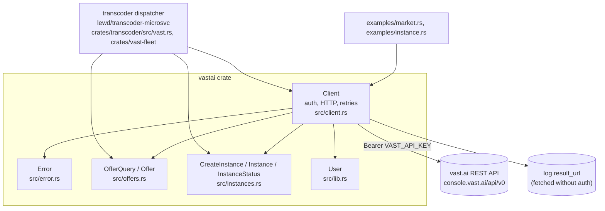

# rs-vastai-sdk: feature docs

> **Last verified against code:** 2026-11-06 @ `f2167ff`

`vastai` (crate name, `Cargo.toml:2`) is an unofficial async Rust client for
the vast.ai REST API at `https://console.vast.ai/api/v0`
(`src/client.rs:14`). It covers what renting GPUs from code needs and nothing
more: search the market, rent an offer on demand or as an interruptible bid,
watch, re-bid, stop, start and destroy instances, attach an ssh key, and read
container logs (`src/lib.rs:1-5`). It is a library: it deploys nothing and has
no CI workflow of its own (there is no `.github/` in the repo). Its one
production consumer is the transcoder's vast.ai dispatcher in
`lewd/transcoder-microsvc` (`crates/transcoder/src/vast.rs` builds the
`Client`, `crates/vast-fleet` plans over `Offer` and `Instance`), which rents
interruptible GPUs when the cluster's transcode capacity is short. The fleet as
lewd.net sees it is described in
[lewd.net's transcoder-fleet.md](../../../../lewd/lewd.net/docs/features/transcoder-fleet.md)
and the dispatcher's behaviour in
[transcoder-microsvc's vast-failover.md](../../../../lewd/transcoder-microsvc/docs/vast-failover.md);
these docs do not repeat either. (Those links are relative to the devenv
checkout, where this repo is `libraries/rs-vastai-sdk`.)

The usage overview, the per-GPU vs. whole-offer price units and the retry
policy are also summarised in the repo's [README](../../README.md).

## Index

| Component | Status | Doc |
|---|---|---|
| Client: auth, HTTP, retries & errors | STABLE | [client.md](./client.md) |
| Offers: market search & query filters | STABLE | [offers.md](./offers.md) |
| Instances: rent, inspect, re-bid, stop, logs, destroy | PARTIAL (status reduction has known misreads) | [instances.md](./instances.md) |
| Testing & examples | PARTIAL (no HTTP-level tests, no CI in this repo) | [testing-and-examples.md](./testing-and-examples.md) |

## Known defects

| Component | Defect | Severity |
|---|---|---|
| Instances | `CreateInstance` derives `Debug` (`src/instances.rs:25`), so `{:?}` of a spec prints `image_login` (a registry password) and every `env` value — the transcoder puts a worker token in `env`. The `Client` itself redacts its key (`src/client.rs:27-34`); the spec does not. | Medium |
| Client / Error | `create_instance` is correctly never retried (`src/client.rs:74-83`), but its errors still answer `is_transient() == true` for any `Transport` error (`src/error.rs:44-49`), including a timeout after Vast received the request. A caller that retries on `is_transient()` can rent twice; the error does not distinguish "never sent" from "answer lost". | Medium |
| Instances | `Instance::status()` returns `Failed` for any `status_msg` containing "error" unless `actual_status == "running"`, and that check runs first (`src/instances.rs:179-181`) — before `Offline` and `Outbid`. An outbid or offline instance whose last message mentions an error reads as `Failed`. | Low |
| Instances | An interruptible instance its owner stopped reads as `Outbid` (`src/instances.rs:185-193`). Deliberate and documented — Vast reports both identically — but a caller that stops its own bids must track that itself. | Low |
| Instances | `logs()` does not retry its `result_url` poll: a transport error on any poll aborts (`src/client.rs:167`), and each poll may take up to the client's 60 s timeout (`src/client.rs:50`), so `wait` can be overrun by up to a minute. | Low |
| Instances | `attach_ssh_key` is a POST retried on 429/5xx (`src/client.rs:117-123`) on the assumption that Vast's `/instances/{id}/ssh/` is idempotent; not verified. | Low |
| Offers | `Offer.gpu_name` and `num_gpus` are required (`src/offers.rs:144-145`): one offer in a search result with either missing or `null` fails the whole `search_offers` call with `Error::Decode`. Not observed in the fixture. | Low |
| Testing | No test exercises the HTTP layer (retry, 404 mapping, `success: false` → `Refused`); only body builders, deserialisation and status reduction are tested. No CI runs `cargo test` here; the consumer's CI is the only gate. | Low |
