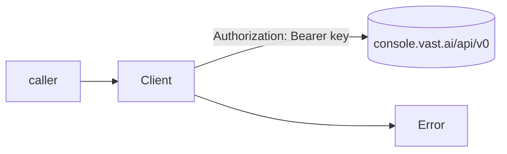

# Client: auth, HTTP, retries & errors

> **Status:** STABLE
> **Owners (code):** `src/client.rs`, `src/error.rs`, `src/lib.rs`
> **Related docs:** [offers.md](./offers.md), [instances.md](./instances.md), [repo README](../../README.md#retries), [lewd.net transcoder-fleet.md](../../../../lewd/lewd.net/docs/features/transcoder-fleet.md)
> **Last verified against code:** 2026-11-06 @ `f2167ff`

## Overview

`Client` is the one entry point: it holds a `reqwest::Client`, the API base
URL and the API key (`src/client.rs:19-25`), is cheap to clone, and every
vast.ai call is a method on it. It sends the key as a bearer token, retries
requests that are safe to repeat, and turns Vast's two ways of saying "no" (an
error status, or a 2xx with `"success": false`) into one `Error` type.

## How it works today

### Data model

No store. `User` (`src/lib.rs:45-58`) is the decoded `GET /users/current/`:
`id`, `username`, `credit` (prepaid dollars), `balance`, `can_pay`; every field
but `id` defaults when missing.

### Interfaces

| Kind | Name / path | Auth | Handler | Notes |
|---|---|---|---|---|
| Constructor | `Client::new(api_key)` | — | `src/client.rs:37-39` | Uses `DEFAULT_BASE_URL` = `https://console.vast.ai/api/v0` (`src/client.rs:14`) |
| Constructor | `Client::with_base_url(api_key, base)` | — | `src/client.rs:41-58` | Trims the key; empty → `Error::MissingApiKey`. Trailing `/` stripped from `base`. 60 s timeout, user agent `rs-vastai-sdk/<version>` |
| HTTP | `GET /users/current/` | Bearer | `current_user` `src/client.rs:61-63` | Retried |
| Error | `Error::{Transport, Status, Refused, Decode, MissingApiKey}` | — | `src/error.rs:3-39` | `thiserror` enum |
| Error helper | `Error::is_transient()` | — | `src/error.rs:44-50` | `Transport`, 429 and ≥500 |
| Error helper | `Error::status()` | — | `src/error.rs:53-58` | HTTP status for `Status` only |

The per-resource calls are documented in [offers.md](./offers.md) and
[instances.md](./instances.md).

### Flow

Every call goes through `send` (`src/client.rs:214-258`):

1. Build `{base}{path}` with `bearer_auth(api_key)` and an optional JSON body
   (`src/client.rs:216-222`).
2. A non-2xx answer → `Error::Status { method, path, status, body }` with
   Vast's body text verbatim (`src/client.rs:226-233`) — for most refusals
   that body is the only explanation (`src/error.rs:8-10`).
3. An empty body → `Value::Null` (`src/client.rs:234-236`); otherwise JSON
   parse, failure → `Error::Decode` (`src/client.rs:237-240`).
4. A JSON object with `"success": false` → `Error::Refused`, message taken
   from `msg`, else `error`, else the whole body (`src/client.rs:241-256`).

Requests safe to repeat go through `retrying` (`src/client.rs:194-212`): up to
`READ_ATTEMPTS = 4` attempts (`src/client.rs:17`) while the error
`is_transient()`, sleeping 500 ms, 1 s, 2 s between them
(`src/client.rs:205`) and logging each at `tracing::debug`. `read` is
`retrying` plus typed decode (`src/client.rs:183-191`).

Which calls retry:

| Call | Retried | Why |
|---|---|---|
| `current_user`, `list_instances`, `get_instance` | yes | reads |
| `search_offers` (a POST) | yes | changes nothing (`src/client.rs:67`) |
| `destroy_instance`, `change_bid`, `set_running`, `attach_ssh_key`, `logs` request | yes | treated as idempotent |
| `create_instance` | **no** | a retry after a lost answer would rent twice (`src/client.rs:74`) |

### Configuration

| Setting | Where | Notes |
|---|---|---|
| API key | passed to `Client::new` | The crate reads no environment itself. Its examples and the lib doc read **`VAST_API_KEY`** (`src/lib.rs:11`, `examples/market.rs:12`, `examples/instance.rs:21`). In production the transcoder dispatcher reads `VAST_API_KEY` (`lewd/transcoder-microsvc/crates/transcoder/src/vast.rs:245`), set by the transcoder chart from Kubernetes Secret **`transcoder-vast`, key `api-key`** (`helm-charts/transcoder/templates/deployment-dispatcher.yaml:100-104`, `helm-charts/transcoder/values-prod.yaml:171-177`). The registry pull login handed to rentals is the same Secret's key `image-login` (`VAST_IMAGE_LOGIN`). The transcoder repo's CI smoke uses the GitHub Actions secret `VAST_API_KEY`. |
| Base URL | `Client::with_base_url` | For a mock server or proxy |
| Timeout | fixed | 60 s per request (`src/client.rs:50`); not configurable |
| TLS | `Cargo.toml` | `reqwest` with `rustls-tls`, no default features |

### Edge cases & gotchas

- **The key is never printed by the client.** `Debug` for `Client` shows only
  `base` (`src/client.rs:27-34`; test `src/client.rs:287-291`). The key never
  appears in a URL (it is a header), so `reqwest::Error` messages in
  `Error::Transport` do not carry it. `CreateInstance`'s `Debug` is a
  different matter — see [instances.md](./instances.md#edge-cases--gotchas).
- **`is_transient()` is about the request, not about safety to retry.** It is
  true for every `Transport` error (`src/error.rs:46`), including a timeout
  after Vast already acted. For `create_instance` that is a double-rent
  footgun: do not retry a rental on `is_transient()` without first listing
  instances by label.
- 4xx other than 429 are final, including 404 (test
  `src/client.rs:293-305`). `get_instance` and `destroy_instance` map 404 to
  "gone" rather than an error (`src/client.rs:99`, `src/client.rs:110`).
- `Refused` is not transient, so a `success: false` read is not retried.
- `method_name` reports any method other than GET/POST/PUT/DELETE as `"?"`
  (`src/client.rs:268-276`); the crate uses no others.
- A bad API key surfaces as a plain `Error::Status` with 401/403; there is no
  dedicated variant.

## History & references

- `3574d43` Add an async client for the vast.ai API — the client, retries and
  error type.
- [Repo README](../../README.md) — prices, interruptible semantics, retries.

## Proposed / Ideas (backlog)

| Idea | Motivation | Sketch | Status |
|---|---|---|---|
| Distinguish "never sent" from "answer lost" | `is_transient()` invites a double rent on `create_instance` (Medium, README known defects) | An `Error::is_safe_to_retry()` that is false for a `Transport` error that is a timeout or a body read on a non-idempotent call; or an `Error::Ambiguous` variant from `create_instance` | Proposed |
| Configurable timeout | 60 s is long for a dashboard read and short for nothing | `Client::builder()` with `timeout`, `attempts` | Proposed |
| HTTP-level tests | Retry, 404 mapping and `Refused` are untested | `with_base_url` against a local mock (e.g. `wiremock`) | Proposed |
