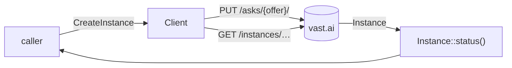
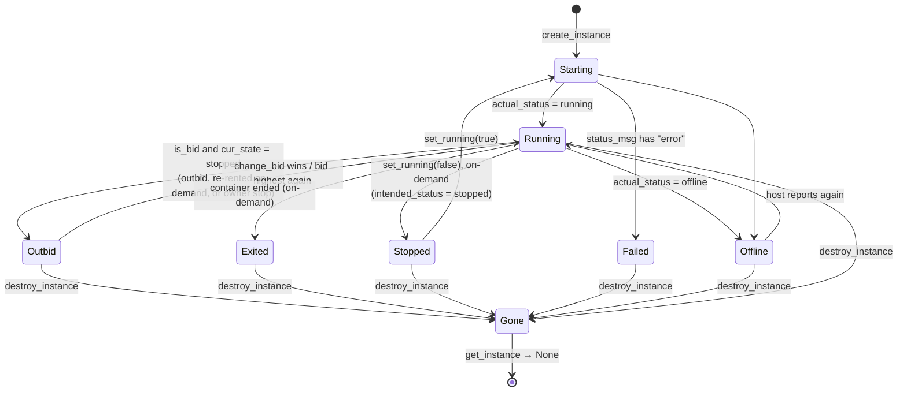

# Instances: rent, inspect, re-bid, stop, logs, destroy

> **Status:** PARTIAL — works as used in production; `Instance::status()` has known misreads (see Edge cases)
> **Owners (code):** `src/instances.rs`, `src/client.rs:74-181`
> **Related docs:** [client.md](./client.md), [offers.md](./offers.md), [repo README](../../README.md#interruptible-instances), [lewd.net transcoder-fleet.md — vast.ai fleet state](../../../../lewd/lewd.net/docs/features/transcoder-fleet.md#vastai-fleet-state), [transcoder vast-failover.md — Lifecycle](../../../../lewd/transcoder-microsvc/docs/vast-failover.md#lifecycle)
> **Last verified against code:** 2026-11-06 @ `f2167ff`

## Overview

Everything after an offer is chosen: rent it (`create_instance`), find it
again (`list_instances`, `get_instance`), reduce Vast's several status strings
to one `InstanceStatus` a controller can act on, raise its bid, stop or start
it, let an ssh key in, read its logs, and destroy it. The transcoder
dispatcher rents one interruptible instance per transcode job and finds its
rentals again by label (`lewd/transcoder-microsvc/crates/vast-fleet/src/lifecycle.rs:3-20`);
what it decides per tick lives there, not here.



## How it works today

### Data model

No store; the instance lives at Vast, keyed on its contract id
(`CreatedInstance.id`, renamed from Vast's `new_contract`,
`src/instances.rs:89-94`).

`CreateInstance` (`src/instances.rs:24-49`) → body of `PUT /asks/{offer_id}/`
(`to_body`, `src/instances.rs:51-87`):

| Field | Sent as | Notes |
|---|---|---|
| `image` | `image` | |
| `env: Vec<(String, String)>` | `env` as a JSON object | No shell quoting needed (`:28-30`; test `:231-251`) |
| `disk_gb` | `disk` | GB |
| `label` | `label` if `Some` | Stored verbatim — the only way to find your own rentals later |
| `bid_per_gpu` | `price` if `Some` | `Some` = interruptible at that **per-GPU** bid; `None` = on demand, no `price` sent (test `:254-262`) |
| `runtype` | `runtype` | `Args` → `"args"` (default: image entrypoint + `args`, no ssh) or `Ssh` → `"ssh_proxy"` (`:4-22`) |
| `args` | `args` if non-empty | Entrypoint arguments for `Args` |
| `onstart` | `onstart` if `Some` | Script for `Ssh`; with `Args` it replaces the entrypoint (`:41-43`) |
| `image_login` | `image_login` if `Some` | `docker login` args: `-u USER -p PASSWORD registry` (`:44-46`) |
| `cancel_unavailable` | `cancel_unavail` | Fail rather than wait if the offer is gone |
| — | `client_id: "me"` | always |

`Instance` (`src/instances.rs:96-145`), typed fields: `id`, `machine_id`,
`label`, `actual_status` (`created`, `loading`, `running`, `exited`,
`offline`, …; `null` before the host reports), `intended_status` (`running` /
`stopped`), `cur_state` (contract: `running` / `stopped`), `next_state`,
`status_msg`, `is_bid`, `gpu_name`, `num_gpus`, `dph_total` (whole instance,
$/h), `min_bid`, `image_uuid`, `start_date` (Unix s), `public_ipaddr`,
`ssh_host`, `ssh_port`, plus `extra` for the rest. `Instance::gpus()` is
`num_gpus` or 1, at least 1 (`src/instances.rs:205-208`).

### Interfaces

| Kind | Name / path | Retried | Handler | Notes |
|---|---|---|---|---|
| HTTP | `PUT /asks/{offer_id}/` | **no** | `create_instance` `src/client.rs:75-83` | Returns `CreatedInstance { id }` |
| HTTP | `GET /instances/?owner=me` | yes | `list_instances` `src/client.rs:86-89` | Every instance on the account; filter by `label` yourself |
| HTTP | `GET /instances/{id}/?owner=me` | yes | `get_instance` `src/client.rs:92-102` | `None` on 404 or `instances: null` (`src/instances.rs:216-219`) |
| HTTP | `DELETE /instances/{id}/` | yes | `destroy_instance` `src/client.rs:106-113` | 404 → `Ok(())`: destroying one already gone succeeds |
| HTTP | `PUT /instances/bid_price/{id}/` | yes | `change_bid` `src/client.rs:126-132` | Body `{client_id: "me", price}` — **per GPU** |
| HTTP | `PUT /instances/{id}/` | yes | `set_running` `src/client.rs:136-146` | `{state: "running" \| "stopped"}`; stopped keeps disk, billed for storage |
| HTTP | `POST /instances/{id}/ssh/` | yes | `attach_ssh_key` `src/client.rs:117-123` | For `RunType::Ssh`; key trimmed |
| HTTP | `PUT /instances/request_logs/{id}/`, then `GET result_url` | request yes, poll no | `logs` `src/client.rs:151-181` | `tail` sent as a string; polls every 500 ms until 2xx or `wait` |
| Method | `Instance::status()` | — | `src/instances.rs:169-203` | Reduction below |

There is no call to set or change a label after rental, and no server-side
label filter: labels are set in `CreateInstance` and matched client-side on
`list_instances()` (the transcoder does exactly this with
`safewords-transcoder:<nonce>`,
`lewd/transcoder-microsvc/crates/vast-fleet/src/lifecycle.rs:16-28`).

### Flow

Golden path, as the transcoder dispatcher and `examples/instance.rs` drive it:

```mermaid
sequenceDiagram
  autonumber
  participant C as Caller
  participant S as vastai::Client
  participant V as vast.ai API
  C->>S: search_offers(OfferQuery .kind(Interruptible) ...)
  S->>V: POST /bundles/ (retried on 429/5xx)
  V-->>S: {offers: [...]}
  S-->>C: Vec<Offer>
  C->>C: pick offer; bid = offer.min_bid_per_gpu() × margin
  C->>S: create_instance(offer.id, CreateInstance{label, bid_per_gpu, ...})
  S->>V: PUT /asks/{offer_id}/ (never retried)
  alt offer gone / bid too low
    V-->>S: 4xx or success:false
    S-->>C: Error::Status / Error::Refused
  else rented
    V-->>S: {success: true, new_contract: id}
    S-->>C: CreatedInstance{id}
  end
  loop poll until the work is done
    C->>S: list_instances() or get_instance(id)
    S->>V: GET /instances/?owner=me
    V-->>S: {instances: [...]}
    S-->>C: Instance → status()
    opt Outbid
      C->>S: change_bid(id, higher per-GPU price)
      S->>V: PUT /instances/bid_price/{id}/
    end
  end
  C->>S: destroy_instance(id)
  S->>V: DELETE /instances/{id}/
  V-->>S: 200 (or 404 → treated as success)
  S-->>C: Ok(())
```

`Instance::status()` checks in this order (`src/instances.rs:169-203`); the
first match wins:

1. `status_msg` contains "error" (case-insensitive) and `actual_status` is not
   `running` → `Failed` (`:179-181`).
2. `actual_status == "offline"` → `Offline` (`:182-184`).
3. `is_bid` and (`cur_state == "stopped"` or `status_msg` contains "outbid")
   → `Outbid` (`:191-193`). Before the intended-stop check because Vast flips
   `intended_status` to `stopped` on preemption too — observed live on
   instance 58593131, 2026-11-01 (`:185-190`, test `:264-275`).
4. `intended_status` (default `running`) `== "stopped"` → `Stopped` (`:194-196`).
5. `actual_status`: `running` → `Running`, `exited` → `Exited`, `stopped` →
   `Stopped`, anything else (including `null`, `created`, `loading`) →
   `Starting` (`:197-202`).

The lifecycle that reduction produces for a rented instance:



`Gone` is not an `InstanceStatus` variant; it is `get_instance` returning
`None` (`src/client.rs:91-102`). An interruptible instance whose container
exits with its contract stopped reads `Outbid`, not `Exited` (test
`src/instances.rs:295-298`); an on-demand one with `cur_state = stopped` but
`intended_status = running` reads `Exited` (`:313-317`).

### Configuration

None in the crate. Image, disk, label, bid and env are all caller-supplied;
for the transcoder's values (`VAST_DISK_GB`, `VAST_IMAGE_LOGIN`, caps) see
[vast-failover.md](../../../../lewd/transcoder-microsvc/docs/vast-failover.md)
and the transcoder chart. `VAST_IMAGE_LOGIN` comes from Kubernetes Secret
`transcoder-vast`, key `image-login`
(`helm-charts/transcoder/templates/deployment-dispatcher.yaml:108-112`).

### Edge cases & gotchas

- **`CreateInstance`'s `Debug` prints secrets.** It derives `Debug`
  (`src/instances.rs:25`), so `{:?}` / `tracing`'s `?spec` shows
  `image_login` (a registry password) and every `env` value. The transcoder
  passes a worker token as `TRANSCODER_API_KEY` in `env`
  (`lewd/transcoder-microsvc/crates/transcoder/src/vast.rs:1225`); it does not
  currently log the spec, but nothing stops it. Medium.
- **Rental is not retried, and a lost answer is ambiguous.** If
  `create_instance` fails with `Error::Transport`, Vast may or may not have
  rented. Before trying again, `list_instances()` and look for the label.
- **Owner-stopped bids read as `Outbid`.** Vast reports an interruptible
  instance you stopped exactly like a preempted one (`src/instances.rs:153-157`).
  Track your own `set_running(false)` calls.
- **`Failed` wins over `Offline` and `Outbid`.** Any "error" in `status_msg`
  while not running is `Failed`, checked first (`:179`). Whether Vast clears
  `status_msg` after a transient error is not known from the code. Low.
- **The instance's `min_bid` is stale after an outbid** (test comment
  `:267-268`; README). Price the machine with
  `OfferQuery::including_rented().eq("machine_id", m)` — see
  [offers.md](./offers.md).
- **`logs` polling.** The `result_url` is fetched with the bare
  `reqwest::Client`, no bearer header (`src/client.rs:167`); a transport
  error on any poll ends the call, and each poll is bounded only by the 60 s
  client timeout, so `wait` can be overrun. A missing `result_url` comes back
  as `Error::Refused` with the whole answer as its message (`:158-164`). Low.
- A stopped instance is still billed for storage until destroyed
  (`src/client.rs:104-105`, `:134-135`; `Offer::storage_dph`).

## History & references

- `3574d43` initial client: create, list, get, destroy, bid, stop/start, logs.
- `a15fa38` Attach ssh keys, expose the ssh proxy, and add an instance example.
- `3e209ed` Read a preempted interruptible instance as outbid.
- [Repo README — Interruptible instances](../../README.md#interruptible-instances).

## Proposed / Ideas (backlog)

| Idea | Motivation | Sketch | Status |
|---|---|---|---|
| Redact `CreateInstance`'s `Debug` | Medium: registry password and env secrets print with `{:?}` | Hand-written `Debug` that prints env keys only and `image_login: <redacted>` | Proposed |
| `find_by_label(prefix)` | Every caller filters `list_instances` by label | Client-side helper; Vast's own label filter, if one exists, unverified | Proposed |
| Status precedence for `Failed` | Outbid/offline with an old error message reads `Failed` | Check `Outbid`/`Offline` before the error substring, or only treat `actual_status` of `created`/`loading` + error as failed | Proposed |
| Retry the log poll's transport errors | One blip ends `logs()` | Reuse the backoff in `retrying`; cap each poll by the remaining `wait` | Proposed |
