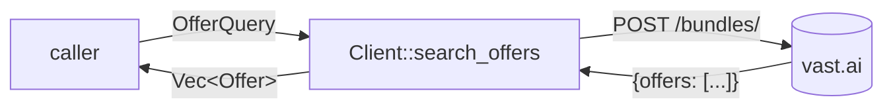

# Offers: market search & query filters

> **Status:** STABLE
> **Owners (code):** `src/offers.rs`, `src/client.rs:65-72`
> **Related docs:** [client.md](./client.md), [instances.md](./instances.md), [repo README](../../README.md#prices-and-units), [transcoder vast-failover.md](../../../../lewd/transcoder-microsvc/docs/vast-failover.md), [lewd.net transcoder-fleet.md — the vast.ai market](../../../../lewd/lewd.net/docs/features/transcoder-fleet.md#the-vastai-market-price--performance)
> **Last verified against code:** 2026-11-06 @ `f2167ff`

## Overview

`OfferQuery` builds the body of Vast's `POST /bundles/` market search;
`Client::search_offers` sends it and returns `Vec<Offer>`. An `Offer` is one
rentable slice of a machine (`src/offers.rs:133-211`), typed for the fields
worth deciding on, with everything else Vast sends kept in `Offer::extra`.
The transcoder dispatcher uses it for its hourly market survey and to price a
machine an instance was outbid on; `vast-fleet` scores and plans over `Offer`
(`lewd/transcoder-microsvc/crates/vast-fleet/src/score.rs:28`,
`planner.rs:16`, `pricing.rs:25`, `perf.rs:15`).



## How it works today

### Data model

No store. The request is a JSON object, one `{field: {op: value}}` per
filtered field plus `type`, `order` and `limit` (`src/offers.rs:17-18`,
`src/offers.rs:109-130`):

```json
{"rentable": {"eq": true}, "rented": {"eq": false},
 "gpu_name": {"in": ["RTX 4060", "L4"]}, "reliability2": {"gte": 0.98},
 "type": "bid", "order": [["dph_total", "asc"]], "limit": 10}
```

The response is `{"offers": [...]}` (`OffersResponse`, `src/offers.rs:232-236`).

`Offer` typed fields (`src/offers.rs:138-211`):

| Field | Unit / meaning |
|---|---|
| `id` | The ask id — what `create_instance` rents (`:139`) |
| `machine_id`, `host_id` | Physical machine; host (`:141-143`) |
| `gpu_name`, `num_gpus` | **Required** — decode fails without them (`:144-145`) |
| `gpu_frac` | Share of the machine's GPUs this offer rents: 1.0 whole, 0.125 one of eight (`:146-152`) |
| `gpu_ram` | VRAM per GPU, MiB (`:153-155`) |
| `compute_cap` | ×100: 890 Ada, 1200 consumer Blackwell (`:156-158`) |
| `driver_version`, `cuda_max_good`, `cpu_name` | as Vast reports |
| `cpu_cores_effective`, `cpu_ram` | This slice's, not the machine's; RAM in MiB (`:165-170`) |
| `disk_space` | Free, GB (`:171-173`) |
| `inet_down`, `inet_up` | Measured Mbit/s (`:174-178`) |
| `inet_down_cost`, `inet_up_cost` | $ per GB (`:179-183`) |
| `dph_base` | GPU+CPU+RAM, **whole offer**, $/h (`:184-186`) |
| `dph_total` | `dph_base` + storage at default disk, whole offer, $/h (`:187-189`) |
| `min_bid` | Lowest bid, **whole offer**, $/h; equals `dph_base` on the interruptible listing (`:190-193`) |
| `storage_cost` | $ per GB per month (`:194-196`) |
| `reliability2` | 0–1 (`:197-199`) |
| `verification`, `geolocation`, `duration` (s listed), `dlperf` | optional |
| `extra` | Every other field, `#[serde(flatten)]` (`:209-210`) |

### Interfaces

| Kind | Name | Handler | Notes |
|---|---|---|---|
| HTTP | `POST /bundles/` | `Client::search_offers` `src/client.rs:66-72` | Retried: a search changes nothing |
| Builder | `OfferQuery::new()` | `src/offers.rs:37-46` | Defaults `rentable = true`, `rented = false`, kind on-demand |
| Builder | `OfferQuery::including_rented()` | `src/offers.rs:48-57` | No default filters: what a machine you were outbid on costs now is only on a rented offer |
| Builder | `.kind(OfferKind)` | `src/offers.rs:59-62` | `OnDemand` → `"on-demand"`, `Interruptible` → `"bid"` (`src/offers.rs:4-15`) |
| Builder | `.eq / .neq / .gte / .lte` | `src/offers.rs:75-89` | One op per call |
| Builder | `.any_of(field, values)` | `src/offers.rs:91-95` | Vast's `in` |
| Builder | `.order_by(field, ascending)` | `src/offers.rs:97-101` | Repeat for tie-breakers |
| Builder | `.limit(n)` | `src/offers.rs:103-106` | |
| Body | `OfferQuery::to_body()` | `src/offers.rs:109-130` | Public, for logging or inspection |
| Price helper | `Offer::min_bid_per_gpu()` | `src/offers.rs:215-217` | `min_bid / max(num_gpus, 1)` — the unit a bid is sent in |
| Price helper | `Offer::dph_per_gpu()` | `src/offers.rs:220-222` | `dph_total / max(num_gpus, 1)` |
| Price helper | `Offer::storage_dph(disk_gb)` | `src/offers.rs:226-229` | `storage_cost × disk_gb / 720` (30-day month) |

### Flow

1. Start from `new()` (or `including_rented()` to price a specific
   `machine_id`).
2. Each filter call goes through `op` (`src/offers.rs:64-73`), which inserts
   into the field's op object, so two bounds on one field both survive
   (`gte` + `lte` → `{"gte": 1, "lte": 2}`; test `src/offers.rs:263-270`).
3. `search_offers` posts `to_body()` and decodes `offers`.

### Configuration

None. Field names and ops are Vast's, passed as strings; the crate validates
neither.

### Edge cases & gotchas

- **Two units.** Every offer price is for the **whole offer**; every bid you
  send is **per GPU** (`src/lib.rs:25-33`). Use `min_bid_per_gpu()` to seed a
  bid, never `min_bid`.
- **`gpu_frac` and NVENC.** On driver 580+ NVENC refuses a session
  (`NV_ENC_ERR_NO_ENCODE_DEVICE`) in a container holding only part of a
  machine (`src/offers.rs:146-150`); an encoder must want `gpu_frac ≈ 1.0`.
  The transcoder applies this in `vast_fleet::gpu::nvenc_reachable`
  (`gpu_frac >= 0.999`,
  `lewd/transcoder-microsvc/crates/vast-fleet/src/gpu.rs:295-296`). The SDK
  types the field but does not filter on it.
- The same op on the same field overwrites: two `eq("x", …)` calls, or two
  `any_of` on one field, keep the last (`src/offers.rs:70`).
- Unknown field names are sent as given; a typo is Vast's to ignore or refuse.
- `num_gpus = 0` is treated as 1 in the per-GPU helpers (test
  `src/offers.rs:311-312`).
- One malformed offer (missing `gpu_name` or `num_gpus`) fails the whole
  search with `Error::Decode` — Low, README known defects.
- `including_rented()` returns offers you cannot rent; do not feed its results
  to `create_instance`.

## History & references

- `3574d43` initial client and query builder.
- `d4494a4` Add `OfferQuery::including_rented`, for pricing a machine you were
  outbid on.
- `f2167ff` Type an offer's `gpu_frac`: NVENC on driver 580+ needs the whole
  machine.
- The market itself (snapshot, price ÷ performance):
  [vast-failover.md](../../../../lewd/transcoder-microsvc/docs/vast-failover.md).

## Proposed / Ideas (backlog)

| Idea | Motivation | Sketch | Status |
|---|---|---|---|
| Tolerate a malformed offer | One bad row fails the whole search | Deserialize `offers` as `Vec<Value>` and skip rows that fail, logging them | Proposed |
| `whole_machine()` filter helper | Every NVENC caller needs `gpu_frac ≥ 1` | `.gte("gpu_frac", 0.999)`, if Vast filters on it server-side (unverified) | Proposed |
