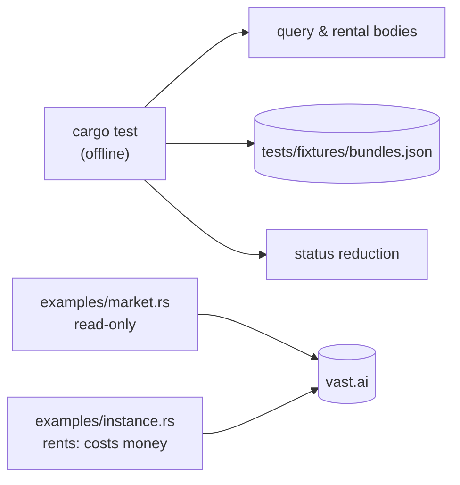

# Testing & examples

> **Status:** PARTIAL — unit tests cover body builders, decoding and status reduction; nothing exercises the HTTP layer, and no CI runs here
> **Owners (code):** `src/*.rs` `#[cfg(test)]` modules, `tests/fixtures/bundles.json`, `examples/market.rs`, `examples/instance.rs`
> **Related docs:** [client.md](./client.md), [offers.md](./offers.md), [instances.md](./instances.md)
> **Last verified against code:** 2026-11-06 @ `f2167ff`

## Overview

Thirteen unit tests, all offline, live beside the code they test. One real
vast.ai response is checked in as a fixture. Two examples drive the real API
with a real key: one read-only, one that spends money. The integration with
real Vast behaviour is proven downstream, by the transcoder's `vast_smoke`
example and its live tests
(`lewd/transcoder-microsvc/crates/transcoder/examples/vast_smoke.rs`,
`crates/transcoder/src/vast.rs:1724-1784`), not here.



## How it works today

### Data model

`tests/fixtures/bundles.json` — a captured `POST /bundles/` response
(`{"offers": [...]}`, e.g. offer 58580551, a Tesla T4 with `gpu_frac`
0.142857). It is not a `tests/` integration test; it is
`include_str!`-ed by a unit test in `src/offers.rs:287`.

### Interfaces

| Kind | Name | Handler | Notes |
|---|---|---|---|
| Test | `an_empty_key_is_refused` | `src/client.rs:282-285` | Whitespace key → `MissingApiKey` |
| Test | `debug_never_prints_the_key` | `src/client.rs:287-291` | |
| Test | `only_rate_limits_and_server_errors_are_transient` | `src/client.rs:293-305` | 429, 503 yes; 400, 404 no |
| Test | `a_query_serialises_as_vasts_filter_object` | `src/offers.rs:242-261` | Full body shape |
| Test | `two_bounds_on_one_field_both_survive` | `src/offers.rs:263-270` | |
| Test | `including_rented_drops_the_default_filters` | `src/offers.rs:272-278` | |
| Test | `on_demand_is_the_default_kind` | `src/offers.rs:280-283` | |
| Test | `real_offers_deserialise_and_keep_unknown_fields` | `src/offers.rs:285-298` | Fixture; `gpu_frac` in (0, 1]; `extra` keeps `gpu_arch` |
| Test | `per_gpu_prices_divide_by_the_gpu_count` | `src/offers.rs:300-313` | Includes `storage_dph` and `num_gpus = 0` |
| Test | `a_bid_rental_sends_the_price_and_the_env_as_an_object` | `src/instances.rs:230-251` | |
| Test | `an_on_demand_rental_sends_no_price` | `src/instances.rs:253-262` | |
| Test | `a_preempted_interruptible_reads_as_outbid_although_vast_says_stopped` | `src/instances.rs:264-275` | Real preemption fields, instance 58593131 |
| Test | `statuses_reduce_to_what_a_controller_acts_on` | `src/instances.rs:277-318` | Starting, Running, Outbid, Offline, Failed, Stopped, Exited |
| Example | `market -- <gpu names…>` | `examples/market.rs` | Read-only: account credit, then the 15 cheapest interruptible offers with `reliability2 ≥ 0.97` |
| Example | `instance -- rent <offer> <bid\|-> <disk_gb> <image> <pubkey file>` | `examples/instance.rs:30-60` | **Spends money.** Rents with `RunType::Ssh`, label `rs-vastai-sdk-example`, `cancel_unavailable`, then attaches the key. `-` rents on demand |
| Example | `instance -- show\|bid\|logs\|destroy <id> …` | `examples/instance.rs:61-87` | `logs` asks for 200 lines, waits 20 s |

### Flow

```sh
cargo test --all-targets          # offline, 13 tests
VAST_API_KEY=... cargo run --example market -- "RTX 4060" "L4"
```

Both examples read the key from `VAST_API_KEY`
(`examples/market.rs:12`, `examples/instance.rs:21`). Run on 2026-11-06 at
`f2167ff`: `cargo test --all-targets` — 13 passed, 0 failed. The examples
were not run for this doc.

### Configuration

`VAST_API_KEY` for the examples only. Never commit a key; the crate's own
`Debug` for `Client` will not print it.

### Edge cases & gotchas

- **`instance rent` costs money and leaves an instance billing until you
  `destroy` it.** There is no cleanup on error: if `attach_ssh_key` fails
  after a successful rental (`examples/instance.rs:58`), the instance stays.
- No test covers `send`/`retrying`: retry counts, backoff, 404 → `None` /
  `Ok(())`, `success: false` → `Refused`, the empty-body → `Null` path, or
  `logs` polling.
- No CI in this repository (no `.github/`). The consumer builds and tests
  this crate as a dependency; a break here shows up there first. Per the
  devenv rule for Rust trunks, run `cargo test --all-targets` before pushing.

## History & references

- `a15fa38` added `examples/instance.rs`.
- `3e209ed` added the real-preemption status test.
- `f2167ff` added the `gpu_frac` assertion on the fixture.

## Proposed / Ideas (backlog)

| Idea | Motivation | Sketch | Status |
|---|---|---|---|
| HTTP-level tests | Retry, 404 and `Refused` handling are untested | `Client::with_base_url` against `wiremock` or a `tokio` TCP stub | Proposed |
| CI workflow | Nothing runs the tests on push | `cargo fmt --check`, `clippy`, `cargo test --all-targets` | Proposed |
| `instance rent` cleanup | A failed key attach leaves a billed instance | Destroy on error after `create_instance` succeeds | Proposed |
